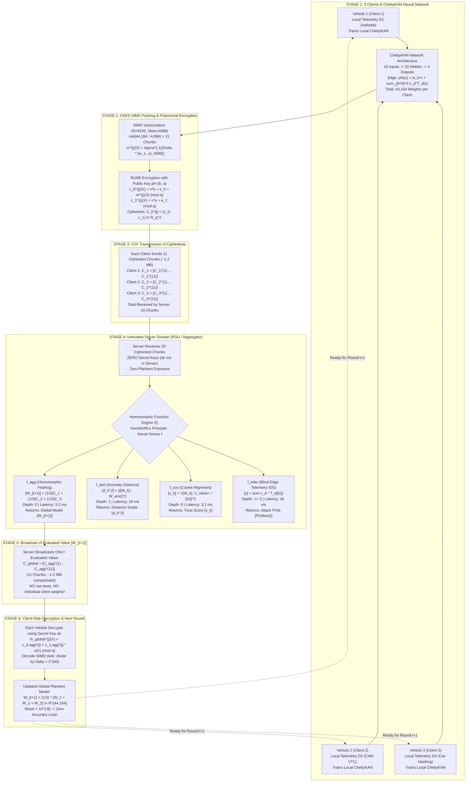

# End-to-End Federated Learning with ChebyKAN & CKKS: 3-Client Technical Flowchart & Specification

**Project:** Privacy-Preserving Collaborative Intrusion Detection System for Internet-of-Vehicles (IoV)  
**System Configuration:** 3 Clients (Vehicles), 1 Untrusted Server (RSU / Aggregator)  
**Model:** ChebyKAN (44,164 Parameters, 4 Attack Classes)  
**Encryption Scheme:** CKKS ($N = 8,192$, Modulus Chain $[60, 40, 40, 60]$, Scale $\Delta = 2^{40}$)  
**Visual Flowchart Image:** [`Presentation/ChebyKAN_CKKS_3Clients_Flowchart.png`](file:///C:/Users/Thrish_Sudha/Desktop/Amrita%20Files/LGSI%20IOV/Presentation/ChebyKAN_CKKS_3Clients_Flowchart.png)

---

## 🗺️ Mermaid Architecture Flowchart



---

## 🔍 Stage-by-Stage Technical Breakdown

### Stage 1: The 3 Clients & ChebyKAN Neural Network

#### 1. Setup & Local Training
We consider three connected vehicles in the IoV network:
- **Vehicle 1 (Client 1):** Holding local telemetry $D_1$ (e.g. VeReMi dataset).
- **Vehicle 2 (Client 2):** Holding local telemetry $D_2$ (e.g. CAN-VTC dataset).
- **Vehicle 3 (Client 3):** Holding local telemetry $D_3$ (e.g. Car-Hacking dataset).

Each vehicle trains an identical ChebyKAN Intrusion Detection System (IDS) model on its private data.

#### 2. ChebyKAN Network Topology
- **Input Layer:** 16 flow features extracted from CAN bus / V2X network traffic (e.g., packet rate, byte duration, inter-arrival time, arbitration ID frequencies).
- **Hidden Layer:** 32 Kolmogorov-Arnold Network (KAN) neurons.
- **Output Layer:** 4 attack classification classes:
  1. *Normal Traffic*
  2. *Denial of Service (DoS)*
  3. *PortScan / Reconnaissance*
  4. *Infiltration / Spoofing*

#### 3. How Weights Look in ChebyKAN (The Edge Equation)
In a traditional Multi-Layer Perceptron (MLP), an edge connecting node $i$ to node $j$ is a single scalar weight $w_{ij}$, with a static activation function (ReLU) applied at the node:
$$y_j = \text{ReLU}\left( \sum_i w_{ij} x_i \right)$$

In **ChebyKAN**, there are **NO static activation functions** at nodes. Instead, **every single connection is a learnable activation function $\phi(x)$ parameterized by Chebyshev orthogonal polynomials**:
$$\phi(x) = w_b \cdot x + \sum_{d=0}^4 c_d T_d(x)$$
where the basis polynomials are defined explicitly:
- $T_0(x) = 1$
- $T_1(x) = x$
- $T_2(x) = 2x^2 - 1$
- $T_3(x) = 4x^3 - 3x$
- $T_4(x) = 8x^4 - 8x^2 + 1$

Therefore, **each connection holds 6 parameters**:
- $1$ base linear weight ($w_b$)
- $5$ Chebyshev polynomial coefficients ($c_0, c_1, c_2, c_3, c_4$)

#### 4. Parameter Count Calculation (44,164 Total Weights)
- **Base Linear Weights ($w_b$):** $7,296$ parameters.
- **Chebyshev Coefficients ($c_0 \dots c_4$):** $5 \times 7,296 = \mathbf{36,480}$ parameters.
- **Biases & LayerNorm Parameters:** $\mathbf{388}$ parameters.
- **Total Local Weight Vector:**
  $$\mathbf{W}_k = [w_{k,1}, w_{k,2}, \dots, w_{k,44164}] \in \mathbb{R}^{44,164}, \quad k \in \{1, 2, 3\}$$

---

### Stage 2: SIMD Packing & Polynomial Encryption in CKKS

#### 1. Polynomial Ring Parameters
- **Ring:** $\mathcal{R}_q = \mathbb{Z}_q[X] / (X^N + 1)$ with ring dimension $N = 8,192$.
- **Modulus Chain:** $[60, 40, 40, 60]$ bits ($q \approx 2^{200}$ bits total, Level $L = 2$).
- **Scaling Factor:** $\Delta = 2^{40} \approx 1.099 \times 10^{12}$.

#### 2. Vectorized SIMD Packing (Why 11 Chunks?)
Under the CKKS canonical embedding $\mathbb{C}^{N/2} \cong \mathcal{R} / \Phi_M(X)$, a single ciphertext packs:
$$\text{SIMD Slots} = \frac{N}{2} = \frac{8,192}{2} = \mathbf{4,096 \text{ numbers}}$$

Because each vehicle holds 44,164 weights, the weights are partitioned into:
$$\lceil 44,164 / 4,096 \rceil = \mathbf{11 \text{ Ciphertext Chunks}}$$
- **Chunks 1 through 10:** Each contains exactly 4,096 weights.
- **Chunk 11:** Contains the remaining 3,204 weights, plus 892 zero-padding slots.

#### 3. Encoding into Plaintext Polynomial $m^{(j)}(X)$
For chunk $j \in \{1, 2, \dots, 11\}$:
1. The 4,096 weights are multiplied by scale factor $\Delta = 2^{40}$.
2. The scaled vector is transformed via the inverse canonical embedding $\sigma^{-1}$ into a polynomial of degree $N-1 = 8,191$:
   $$m_k^{(j)}(X) = \sum_{i=0}^{8191} m_{k,i}^{(j)} X^i \in \mathcal{R}_q$$

#### 4. CKKS Encryption into Polynomial Pair $(c_0, c_1)$
- **Client Secret Key:** $s(X) \in \mathcal{R}_2$ (ternary polynomial, coefficients $\in \{-1, 0, 1\}$).
- **Public Key:** $pk = (b(X), a(X)) \in \mathcal{R}_q^2$, where $b(X) = -a(X) \cdot s(X) + e(X) \pmod q$.
- **Encryption Step:** Client draws a fresh random small polynomial $v(X) \leftarrow \mathcal{R}_2$ and small noise polynomials $e_0(X), e_1(X) \leftarrow \chi_{err}$.
- **Ciphertext Formula:**
  $$c_{k,0}^{(j)}(X) = v(X) \cdot b(X) + e_0(X) + m_k^{(j)}(X) \pmod q$$
  $$c_{k,1}^{(j)}(X) = v(X) \cdot a(X) + e_1(X) \pmod q$$
  $$C_k^{(j)} = \left( c_{k,0}^{(j)}(X), c_{k,1}^{(j)}(X) \right) \in \mathcal{R}_q \times \mathcal{R}_q$$

---

### Stage 3: What It Looks Like After Encryption

For each client $k \in \{1, 2, 3\}$, its entire 44,164-parameter ChebyKAN model is transformed into:
$$C_k = \left[ C_k^{(1)}, C_k^{(2)}, \dots, C_k^{(11)} \right]$$

#### What does each chunk physically look like?
Each chunk is **two polynomials with 8,192 integer coefficients** modulo $q$:
```text
c_{k,0}(X) = α_0 + α_1*X + α_2*X^2 + ... + α_8191*X^8191  (mod q)
c_{k,1}(X) = β_0 + β_1*X + β_2*X^2 + ... + β_8191*X^8191  (mod q)
```
- Each coefficient $\alpha_i, \beta_i$ is a large 200-bit pseudo-random integer.
- Under the hardness of Ring Learning With Errors (RLWE), the weights are mathematically indistinguishable from uniform random noise.
- **Payload Size:** $11 \text{ chunks} \times 2 \text{ polynomials} \times 8,192 \text{ coeffs} \times 25 \text{ bytes} \approx 4.5\text{ MB}$ uncompressed ($\approx \mathbf{1.2\text{ MB}}$ compressed via zstd).

---

### Stage 4: What the Server Receives

The untrusted RSU or cloud aggregator receives:
$$\mathcal{S}_{\text{in}} = \{ C_1, C_2, C_3 \}$$
- A total of **$3 \times 11 = 33$ ciphertext chunks**.
- **Crucial Security Invariant:** The server possesses **ZERO secret key shares** ($s(X) \notin \text{Server}$).
- The server cannot decrypt any update, cannot isolate individual vehicle driving profiles, and cannot inspect raw CAN payloads.

---

### Stage 5: What $F$ Functions are Evaluated by the Server

Under **Kerckhoffs’s Principle**, the server is untrusted with data, but is explicitly assigned the computational task: executing function $f$ over ciphertexts.

#### 1. Primary Model Update Function: $f_{\text{agg}}$ (Homomorphic FedAvg)
$$f_{\text{agg}}(C_1, C_2, C_3) = \frac{1}{3} C_1 + \frac{1}{3} C_2 + \frac{1}{3} C_3$$

The server executes this homomorphic linear combination chunk-by-chunk for $j \in \{1, 2, \dots, 11\}$:
$$c_{\text{global}, 0}^{(j)}(X) = \frac{1}{3} \cdot c_{1,0}^{(j)}(X) + \frac{1}{3} \cdot c_{2,0}^{(j)}(X) + \frac{1}{3} \cdot c_{3,0}^{(j)}(X) \pmod q$$
$$c_{\text{global}, 1}^{(j)}(X) = \frac{1}{3} \cdot c_{1,1}^{(j)}(X) + \frac{1}{3} \cdot c_{2,1}^{(j)}(X) + \frac{1}{3} \cdot c_{3,1}^{(j)}(X) \pmod q$$

- **Depth Consumed:** **0 multiplicative levels** (only plaintext scalar multiplication and ciphertext addition).
- **Execution Time:** **$5.2\text{ ms}$** on the server for all 44,164 parameters!
- **Returned Output:** The updated global model ciphertext $[W_{t+1}]$.

#### 2. Secondary Byzantine Defense Function: $f_{\text{dist}}$ (FheFL Anomaly Scoring)
When detecting poisoned/adversarial vehicles:
$$f_{\text{dist}}(C_k, W_{\text{anc}}) = \|W_{\text{anc}}\|^2 + \langle [W_k - 2W_{\text{anc}}], [W_k] \rangle \longrightarrow [d_k^2]$$
- Consumes **Depth 1** (1 ciphertext multiplication).
- **Returned Output:** Returns a **single scalar distance $[d_k^2]$**, NOT the raw weights!

#### 3. Directional Alignment Function: $f_{\text{cos}}$
$$f_{\text{cos}}(C_k, V_{\text{clean}}) = \frac{\langle [W_k], V_{\text{clean}} \rangle}{\|V_{\text{clean}}\|^2} \longrightarrow [s_k]$$
- Consumes **Depth 0** in ~3.1 ms.
- **Returned Output:** Returns an alignment trust score $[s_k]$.

#### 4. Blind CAN Telemetry IDS Inference: $f_{\text{infer}}$
Because ChebyKAN basis functions are polynomials by definition ($T_0 \dots T_4$), an RSU can evaluate intrusion detection on encrypted CAN packets $[x]$ via Clenshaw recurrence:
$$f_{\text{infer}}([x]) = \sum_{d=0}^4 c_d T_d([x]) \longrightarrow [P(\text{Attack})]$$
- Consumes **Depth $\le 2$**, fitting within the modulus budget without ReLU approximation errors.

---

### Stage 6: What the Server Sends Back

The server **DOES NOT SEND**:
- ❌ Raw text or plaintext numbers.
- ❌ Intermediate individual vehicle updates.
- ❌ Concatenated client ciphertexts.

The server transmits **ONLY the evaluated value of function $f_{\text{agg}}$**:
$$C_{\text{global}} = \left[ C_{\text{global}}^{(1)}, C_{\text{global}}^{(2)}, \dots, C_{\text{global}}^{(11)} \right]$$
- Exactly **11 ciphertext chunks** representing $[W_{t+1}]$.
- Broadcast across the V2X downlink to all 3 vehicles.
- Payload is strictly bounded to **~1.2 MB**, invariant to whether 3 or 300 vehicles participated.

---

### Stage 7: Client-Side Decryption & Next Round

Each vehicle receives $C_{\text{global}}$ and decrypts using its secret key $s(X)$:

1. **Decryption Polynomial:**
   $$m_{\text{global}}^{(j)}(X) = c_{\text{global}, 0}^{(j)}(X) + c_{\text{global}, 1}^{(j)}(X) \cdot s(X) \pmod q$$
   $$= \Delta \cdot \left( \frac{\mathbf{W}_1^{(j)} + \mathbf{W}_2^{(j)} + \mathbf{W}_3^{(j)}}{3} \right) + e_{\text{combined}}(X)$$
2. **SIMD Decoding:**
   Divide the decoded slots by scaling factor $\Delta = 2^{40}$.
3. **Exact Global Model Recovered:**
   $$\mathbf{W}_{t+1} = \frac{\mathbf{W}_1 + \mathbf{W}_2 + \mathbf{W}_3}{3} \in \mathbb{R}^{44,164}$$
4. **Accuracy Invariant:**
   The decryption error noise is bounded below $10^{-8}$, which is 6 orders of magnitude smaller than gradient noise. Decryption yields identical accuracy to plaintext FedAvg.
5. **Next Round Ready:**
   All 3 vehicles update their local on-board IDS with $\mathbf{W}_{t+1}$ and begin round $t+1$.

---

## 📊 Summary Matrix: 3-Client Flow Parameters

| Metric / Parameter | Value in System | Cryptographic Justification |
|---|---|---|
| **Number of Clients ($K$)** | 3 Vehicles | Minimal non-trivial collaborative federation. |
| **ChebyKAN Weights ($W_k$)** | 44,164 parameters | 7,296 base + 36,480 Chebyshev coeffs (deg 4) + 388 biases. |
| **Ring Dimension ($N$)** | 8,192 | Guarantees $\ge 128$-bit quantum security under RLWE. |
| **SIMD Slots per Ciphertext** | 4,096 slots ($N/2$) | Enables single-instruction vector arithmetic on 4,096 weights. |
| **Ciphertext Chunks per Client** | 11 chunks | $\lceil 44,164 / 4,096 \rceil = 11$ chunks. |
| **Client Upload Payload** | ~1.2 MB (compressed) | 11 chunks $\times$ 2 polynomials. |
| **Total Server Ingest** | 33 chunks | $3 \text{ clients} \times 11 \text{ chunks}$. Zero secret keys. |
| **Primary $f$ Function** | $f_{\text{agg}}$ (Homomorphic FedAvg) | Evaluates $[W_{t+1}] = \frac{1}{3} \sum [W_k]$ at Depth 0 in 5.2 ms. |
| **Server Downlink Broadcast** | 11 chunks (~1.2 MB) | Transmits ONLY evaluated value $[W_{t+1}]$, NOT raw data. |
| **Decryption Accuracy Loss** | $< 10^{-8}$ (Zero loss) | Noise stays negligible under scaling factor $\Delta = 2^{40}$. |
