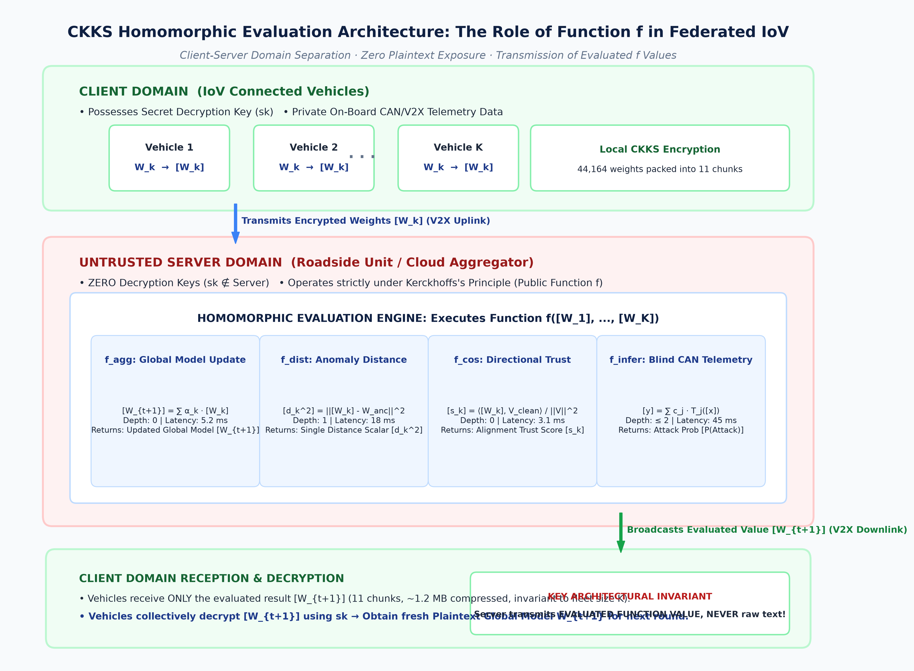
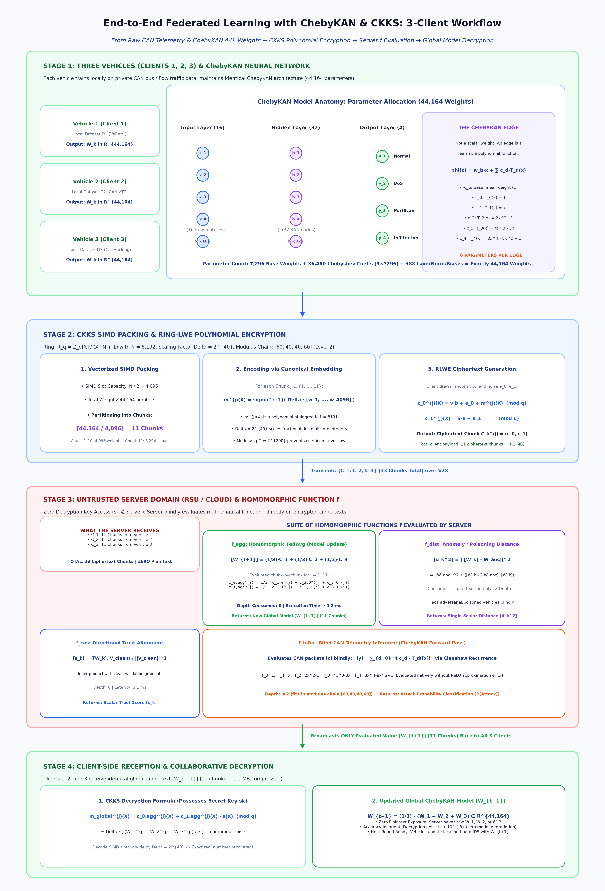
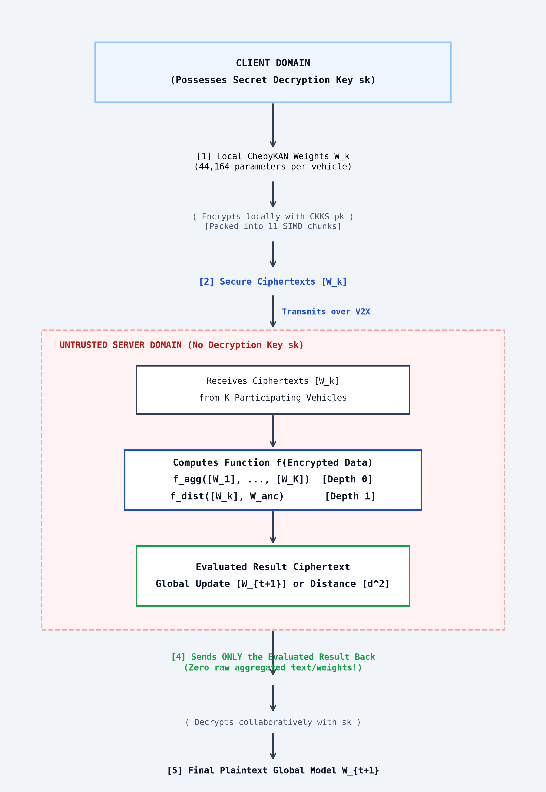

# Complete Technical Specification: Privacy-Preserving IoV Intrusion Detection System
## Chebyshev KAN (ChebyKAN) + Federated Learning + Multi-Key CKKS Homomorphic Encryption

---

## 1. Executive System Architecture

This system implements an enterprise-grade, privacy-preserving Intrusion Detection System (IDS) tailored for the **Internet of Vehicles (IoV)**. It protects Controller Area Network (CAN) bus communications and Vehicle-to-Everything (V2X) telemetry against cyberattacks (DoS, Fuzzy, Impersonation, Gear/RPM spoofing) without exposing raw vehicle sensor data or individual model weights.

### System Topography
The system operates across three tiers:
1. **Vehicular Edge Tier (IoV Clients / ECUs):** Captures high-frequency CAN messages, extracts 46 sliding-window features, trains a local Chebyshev Kolmogorov-Arnold Network (ChebyKAN), and encrypts model parameter gradients using CKKS homomorphic encryption.
2. **Intermediate Edge Tier (Roadside Units / Edge Gateways):** Receives encrypted model chunks over ECDH-authenticated channels, enforces atomic block reception, and performs intermediate homomorphic additions.
3. **Cloud Aggregation Tier (Central Server):** Computes privacy-preserving Byzantine distance metrics on ciphertexts, applies quality weighting, decrypts only the collective aggregate, and broadcasts the updated global model.



---

## 2. Deep Dive: ChebyKAN Neural Network Architecture

### 2.1 Weight vs. Parameter vs. Node

To eliminate ambiguity across our team, we define these standard terms rigorously:

| Term | Definition | ChebyKAN Example |
| :--- | :--- | :--- |
| **Node (Neuron)** | A computation unit in a layer that holds an activation value. Nodes are *not* counted as weights. | Layer 1 has 64 nodes; Layer 2 has 64 nodes; Layer 3 has 4 nodes. |
| **Weight** | A single trainable multiplicative coefficient connecting inputs to outputs. | Base weights $w_b$ and Chebyshev coefficients $c_p$. |
| **Bias** | An additive trainable scalar added per node to shift activation thresholds. | 64 biases in Layer 1; 64 biases in Layer 2; 4 biases in Layer 3. |
| **Parameter** | Any learnable numerical value updated during backpropagation: $\text{Parameters} = \text{Weights} + \text{Biases} + \text{Normalization Params}$. | The network has **exactly 44,164 parameters**. |

---

### 2.2 Mathematical Formulation of ChebyKAN

Unlike traditional Multilayer Perceptrons (MLPs) that use fixed node activations (e.g., ReLU, GeLU) and linear edge weights ($y = \sigma(Wx + b)$), a **Kolmogorov-Arnold Network (KAN)** places learnable, non-linear activation functions on the edges:

$$\phi(x) = \text{base\_component}(x) + \text{spline\_component}(x)$$

In **ChebyKAN**, the spline component is parameterized using **orthogonal Chebyshev polynomials of the first kind** ($T_p(x)$) of degree $D = 4$:

$$T_0(x) = 1$$
$$T_1(x) = x$$
$$T_2(x) = 2x^2 - 1$$
$$T_3(x) = 4x^3 - 3x$$
$$T_4(x) = 8x^4 - 8x^2 + 1$$

Recurrence relation:
$$T_p(x) = 2x \cdot T_{p-1}(x) - T_{p-2}(x) \quad \text{for } p \ge 2$$

For an input feature $x \in [-1, 1]$ (enforced via $\tanh(x)$), the 1D edge activation from input $i$ to output $j$ is:

$$\phi_{i,j}(x) = w_{b, i, j} \cdot \text{SiLU}(x) + \sum_{p=0}^{D} c_{p, i, j} \cdot T_p(\tanh(x))$$

Where:
- $w_{b, i, j}$: Trainable **Base Weight** acting on the standard SiLU activation.
- $c_{p, i, j}$: Trainable **Chebyshev Polynomial Coefficients** for degrees $p \in \{0, 1, 2, 3, 4\}$ ($D+1 = 5$ coefficients per edge).

The output of node $j$ is computed by summing the edge activations and adding a node bias:

$$y_j = \text{bias}_j + \sum_{i=1}^{d_{\text{in}}} \phi_{i,j}(x_i)$$

---

### 2.3 The Exact Math Yielding 44,164 Parameters

With 46 input CAN features and 4 intrusion detection output classes (`Normal`, `DoS`, `Fuzzy`, `Impersonation`), the layer parameters are calculated as follows:

```
Input Features: 46
Hidden Dimension: 64
Chebyshev Degree: 4 (Degree + 1 = 5 polynomial terms per edge)
Output Classes: 4
```

#### Layer 1: Input (46) ──► Hidden (64)
- **Base Weights:** $46 \times 64 = 2,944$
- **Chebyshev Coefficients:** $46 \times 64 \times 5 = 14,720$
- **Node Biases:** $64$
- **Layer Subtotal:** $2,944 + 14,720 + 64 = 17,728$
- **Normalization (LayerNorm):** $64 \text{ (scale } \gamma) + 64 \text{ (shift } \beta) = 128$
- **Total Layer 1:** $17,728 + 128 = \mathbf{17,856}$

#### Layer 2: Hidden (64) ──► Hidden (64)
- **Base Weights:** $64 \times 64 = 4,096$
- **Chebyshev Coefficients:** $64 \times 64 \times 5 = 20,480$
- **Node Biases:** $64$
- **Layer Subtotal:** $4,096 + 20,480 + 64 = 24,640$
- **Normalization (LayerNorm2):** $64 \text{ (scale } \gamma) + 64 \text{ (shift } \beta) = 128$
- **Total Layer 2:** $24,640 + 128 = \mathbf{24,768}$

#### Layer 3: Hidden (64) ──► Output Classes (4)
- **Base Weights:** $64 \times 4 = 256$
- **Chebyshev Coefficients:** $64 \times 4 \times 5 = 1,280$
- **Node Biases:** $4$
- **Layer Subtotal:** $256 + 1,280 + 4 = \mathbf{1,540}$

#### Network Grand Total
$$\text{Total Parameters} = 17,856 + 24,768 + 1,540 = \mathbf{44,164} \text{ parameters}$$

---

## 3. CKKS Homomorphic Encryption & SIMD Vector Packing

### 3.1 What is SIMD Packing?

In the Cheon-Kim-Kim-Song (**CKKS**) homomorphic encryption scheme, plaintext data is encoded into cyclotomic polynomial rings $R_Q = \mathbb{Z}_Q[X]/(X^N + 1)$, where $N$ is the polynomial degree (power of 2).

Using canonical complex embedding (the complex CRT isomorphism), a single ring polynomial of degree $N = 8,192$ packs a vector of:

$$N_{\text{slots}} = \frac{N}{2} = \frac{8,192}{2} = 4,096 \text{ complex (or real) floating-point numbers}$$

**SIMD (Single Instruction, Multiple Data):** When two ciphertexts $[c_A]$ and $[c_B]$ are added or multiplied, the algebraic ring operations execute on all 4,096 slots simultaneously in parallel:

$$[c_A] \oplus [c_B] \implies \vec{z}[i] \approx \vec{a}[i] + \vec{b}[i] \quad \forall i \in \{0, 1, \dots, 4095\}$$

---

### 3.2 Whole-Vector Packing vs. Tensor-by-Tensor Encryption

In early prototypes (e.g. Month 4), each parameter matrix was encrypted in a separate ciphertext. For example, a 4-element output bias was encrypted in an entire 4,096-slot ciphertext, wasting $99.9\%$ of the slots, increasing memory usage by $12\times$, and drastically inflating network bandwidth.

In our production pipeline ([`fhe_adapter.py`](file:///C:/Users/Thrish_Sudha/Desktop/Amrita%20Files/LGSI%20IOV/Team/LG_IoV/NewModel/federated/fhe_adapter.py)), all 44,164 parameters are flattened into a contiguous 1D array and packed sequentially across SIMD blocks.

$$\text{Number of Ciphertext Blocks } B = \left\lceil \frac{d}{N_{\text{slots}}} \right\rceil = \left\lceil \frac{44,164}{4,096} \right\rceil = \mathbf{11} \text{ blocks}$$

#### Exact Slot Allocation Map

```
Block 0:  Parameters      0 to  4,095  (4,096 real weights)
Block 1:  Parameters  4,096 to  8,191  (4,096 real weights)
Block 2:  Parameters  8,192 to 12,287  (4,096 real weights)
Block 3:  Parameters 12,288 to 16,383  (4,096 real weights)
Block 4:  Parameters 16,384 to 20,479  (4,096 real weights)
Block 5:  Parameters 20,480 to 24,575  (4,096 real weights)
Block 6:  Parameters 24,576 to 28,671  (4,096 real weights)
Block 7:  Parameters 28,672 to 32,767  (4,096 real weights)
Block 8:  Parameters 32,768 to 36,863  (4,096 real weights)
Block 9:  Parameters 36,864 to 40,959  (4,096 real weights)
Block 10: Parameters 40,960 to 44,163  (3,204 real weights + 892 zero-padding slots)
---------------------------------------------------------------------------------
TOTAL:    11 CKKS Ciphertexts = 44,164 Weights Encrypted
```



---

## 4. The Complete $F$ Function: Global Model Aggregation Workflow

The $F$ function denotes the complete end-to-end mathematical and cryptographic transformation mapping distributed client data into an updated global model $M_G(t+1)$:

$$M_G(t+1) = F\Big( M_G(t), \big\{ D_k \big\}_{k \in S_t}, \text{Keys} \Big)$$



### Step-by-Step Mathematical Pipeline

#### 1. Plaintext Model Broadcast
The cloud server flattens and broadcasts the current global model weights $w_t \in \mathbb{R}^{44,164}$ to all active vehicles in cohort $S_t$ over ECDH-authenticated channels:
$$w_t = \text{flatten}\left(M_G(t)\right)$$

#### 2. Local Training on Vehicular Edge
Each client vehicle $k \in S_t$ initializes its local ChebyKAN model with $w_t$ and trains for $E$ epochs on its local non-IID dataset $D_k$, minimizing regularized cross-entropy loss:
$$w_{k, t} \leftarrow w_t - \eta \nabla L_{\text{reg}}\left(w_t; D_k\right)$$
The client extracts the local model difference vector:
$$\Delta w_{k, t} = w_{k, t} - w_t \in \mathbb{R}^{44,164}$$

#### 3. CKKS Encryption
Client $k$ slices $\Delta w_{k,t}$ into 11 chunks, encoding each into a SIMD plaintext and encrypting it under its public key:
$$[\Delta w_{k, t}] = \Big\{ \text{Enc}_{\text{pk}_k}\big(\Delta w_{k, t}^{(0)}\big), \dots, \text{Enc}_{\text{pk}_k}\big(\Delta w_{k, t}^{(10)}\big) \Big\}$$
The client transmits the 11 ciphertext blocks along with its sample count $n_{k,t} = |D_k|$.

#### 4. Byzantine Distance Scoring & Weight Calculation
The server homomorphically computes the squared Euclidean distance between each client update and the previous model:
$$[d_{k, t}] = \|\Delta w_{k, t}\|^2$$
In the practical profile, distance scalar $d_{k, t}$ is revealed (one scalar per client vs. 44,164 parameters). The server evaluates non-poisoning quality rates:
$$p_{k, t} = \max\left(1 - \frac{d_{k, t}}{\sum_{j \in S_t} d_{j, t}}, 0\right)$$
The final aggregation weight is computed as the normalized joint product of quality and sample size:
$$\omega_{k, t} = \frac{n_{k, t} \cdot p_{k, t}}{\sum_{j \in S_t} n_{j, t} \cdot p_{j, t}}$$

#### 5. Homomorphic Plaintext-Ciphertext Multiplication & Addition
The edge/cloud aggregator multiplies the plaintext scalar weights $\omega_{k,t}$ into the ciphertext vectors and accumulates:
$$[\Delta w_t] = \sum_{k \in S_t} \omega_{k, t} \odot [\Delta w_{k, t}] = \left\{ \sum_{k \in S_t} \omega_{k, t} \odot \left[\Delta w_{k, t}^{(b)}\right] \right\}_{b=0}^{10}$$

#### 6. Collective Decryption & Global Model Update
The collaborative secret key holders decrypt the aggregated update $[\Delta w_t]$. The server recovers the plaintext update vector:
$$\Delta w_t = \text{Dec}_{\text{agg}}\left( [\Delta w_t] \right) \in \mathbb{R}^{44,164}$$
The global model is updated:
$$w_{t+1} = w_t + \Delta w_t$$

---

## 5. Main Design Question: Constant vs. Variable Records

### 5.1 The Question
Are records contributed by each client per time interval:
1. Constant?
2. Variable?
3. Configured but not guaranteed?

### 5.2 Evidence-Based Conclusion
The records are **VARIABLE (Category 2)**.

#### Rigorous Distinction of Four Quantities:
1. **Total records assigned to a client ($|D_k|$):** **Variable.** Generated by Dirichlet non-IID partitioning (`dirichlet_partition(labels, alpha=0.3)`). Empirically:
   - For $N=10,000$, $\alpha=0.3$, $K=5$: counts range from **$180$ to $5,573$ records** ($\mu = 2,000.0, \sigma = 2,033.8$).
   - For $N=50,000$, $\alpha=0.3$, $K=10$: counts range from **$371$ to $17,426$ records** ($\mu = 5,000.0, \sigma = 5,283.5$).
2. **Records observed by a client during time interval $\Delta T$:** **Variable.** In real IoV networks, message transmission is bursty and dependent on vehicle speed, maneuvers, and attack frequency. A quiet vehicle observes fewer CAN frames than a vehicle undergoing a high-frequency DoS injection.
3. **Records used for local training ($n_{k,t}^{\text{train}}$):** **Variable across clients**, but static across rounds in offline batch simulation (`len(client_subset)`).
4. **Sample count $n_{k,t}$ in the $F$ function:** **Dynamic scalar** representing the exact sample mass $|D_{k,t}|$.

---

### 5.3 Cryptographic Independence: Why Variable Records Do NOT Break Fixed CKKS Vectors

A frequent point of confusion is whether variable dataset records break fixed-size CKKS ciphertext packaging. **They do not.**

```
DATASET SPACE (Variable):
  Vehicle A:   371 records  ──────┐
  Vehicle B: 2,140 records  ──────┼──► Trained via Backprop
  Vehicle C: 9,850 records  ──────┘

MODEL PARAMETER SPACE (Strictly Constant d = 44,164):
  Vehicle A Update: Δw_A ∈ ℝ⁴⁴¹⁶⁴  (Length = 44,164 floats)
  Vehicle B Update: Δw_B ∈ ℝ⁴⁴¹⁶⁴  (Length = 44,164 floats)
  Vehicle C Update: Δw_C ∈ ℝ⁴⁴¹⁶⁴  (Length = 44,164 floats)

CIPHERTEXT SPACE (Strictly Constant B = 11 Blocks):
  Enc(Δw_A) = 11 CKKS Ciphertexts (4,096 slots each)
  Enc(Δw_B) = 11 CKKS Ciphertexts (4,096 slots each)
  Enc(Δw_C) = 11 CKKS Ciphertexts (4,096 slots each)
```

**Key Insight:** CKKS encrypts **model weights ($\Delta w$)**, **never dataset samples**! Regardless of whether a vehicle processed 50 samples or 50,000 samples, its ChebyKAN parameter gradient vector is always exactly 44,164 floats.

---

## 6. Fault Tolerance: Handling Missing & Dropped Updates

### 6.1 The Complete-Update Rule (Atomicity)
In vehicular networks, wireless fading and mobility cause dropped packets:
- An update from client $k$ consists of **11 ciphertext blocks**.
- **Rule:** If client $k$ delivers $10$ out of $11$ blocks, the entire update is considered corrupt and **dropped immediately**:
  $$S_t = \Big\{ k \in \text{Selected}_t \;\Big|\; \text{ChunksReceived}(k) = 11 \;\wedge\; \text{MAC\_Verify}(k) = \text{Valid} \Big\}$$
- Partial vectors cannot be added homomorphically because missing slots cause misaligned parameter corruption across the layer matrices.

### 6.2 Dynamic Denominator Normalization
The normalization denominator must **never** be hardcoded to the total registered fleet size $N$ or expected sample count:
$$\text{Denominator}_t = \sum_{k \in S_t} n_{k, t} \cdot p_{k, t}$$
By summing strictly over the surviving client set $S_t$, the global aggregate remains mathematically unbiased and normalized to $1.0$.

### 6.3 Eliminating Homomorphic Division
Homomorphic division $\frac{[c_1]}{[c_2]}$ is non-linear and computationally intractable in CKKS without hundreds of iterations of polynomial approximation.
Because $n_{k,t}$ and $p_{k,t}$ are transmitted as authenticated scalar metadata, the aggregator computes the normalized weight $\omega_{k,t}$ in **plaintext**:
$$\omega_{k, t} \in \mathbb{R} \quad \text{(computed in microseconds on CPU)}$$
The aggregator then applies native **plaintext-ciphertext multiplication** $\omega_{k,t} \odot [\Delta w_{k,t}]$, which consumes zero multiplication levels and requires no division.

---

## 7. Implementation File Map & Verification Cross-References

| Component | Repository File | Line Reference | Key Invariant / Mechanism |
| :--- | :--- | :--- | :--- |
| **CAN Feature Extractor** | [`can_features.py`](file:///C:/Users/Thrish_Sudha/Desktop/Amrita%20Files/LGSI%20IOV/Team/LG_IoV/NewModel/data/can_features.py) | `L50-L90`, `L93-L150` | 46 features, 64-window, stride 16, 6400-block splitting |
| **Leak-Free Splitter** | [`preprocess.py`](file:///C:/Users/Thrish_Sudha/Desktop/Amrita%20Files/LGSI%20IOV/Team/LG_IoV/NewModel/data/preprocess.py) | `L42-L69` | `assert_no_group_overlap`: zero window leakage across train/test |
| **Dirichlet Partitioner** | [`partition.py`](file:///C:/Users/Thrish_Sudha/Desktop/Amrita%20Files/LGSI%20IOV/Team/LG_IoV/NewModel/federated/partition.py) | `L53-L96` | Non-IID Dirichlet distribution ($\alpha=0.3/0.5$), variable $n_k$ |
| **ChebyKAN Model** | [`cheby_kan.py`](file:///C:/Users/Thrish_Sudha/Desktop/Amrita%20Files/LGSI%20IOV/Team/LG_IoV/NewModel/models/cheby_kan.py) | Full Class | Exactly **44,164 parameters**, degree 4 Chebyshev orthogonal basis |
| **SIMD Ciphertext Adapter** | [`fhe_adapter.py`](file:///C:/Users/Thrish_Sudha/Desktop/Amrita%20Files/LGSI%20IOV/Team/LG_IoV/NewModel/federated/fhe_adapter.py) | `L80-L160` | Whole-vector flattening, $N=8192$, 11 ciphertext blocks |
| **Vehicular Client** | [`client.py`](file:///C:/Users/Thrish_Sudha/Desktop/Amrita%20Files/LGSI%20IOV/Team/LG_IoV/NewModel/federated/client.py) | `L78-L140` | `local_train` on $n_{k}$, packages encrypted update & sample size |
| **Aggregation Server** | [`server.py`](file:///C:/Users/Thrish_Sudha/Desktop/Amrita%20Files/LGSI%20IOV/Team/LG_IoV/NewModel/federated/server.py) | `L216-L306` | Multi-key handling, distance revelation, $p^u$ rates, homomorphic add |
| **Training Coordinator** | [`train_federated.py`](file:///C:/Users/Thrish_Sudha/Desktop/Amrita%20Files/LGSI%20IOV/Team/LG_IoV/NewModel/train_federated.py) | `L198-L236` | Orchestrates rounds, evaluates global test loss and accuracy |

---

## 8. Summary Checklist for Teammates

- [x] **Model Parameters:** $44,164$ floats (not nodes, not records).
- [x] **Ciphertext Geometry:** $11$ blocks of $4,096$ slots ($N=8,192, \text{scale}=2^{40}$).
- [x] **Records per Client:** **Variable** ($n_{k,t}$ varies by client and time interval).
- [x] **Ciphertext Size:** **Strictly Constant** across all clients regardless of dataset size.
- [x] **Homomorphic Operations:** Addition and Plaintext-Scalar Multiplication only (no expensive homomorphic division).
- [x] **Dropout Resilience:** Atomic 11-chunk requirement; dynamic normalization denominator $\sum_{k \in S_t} \omega_{k,t}$.
